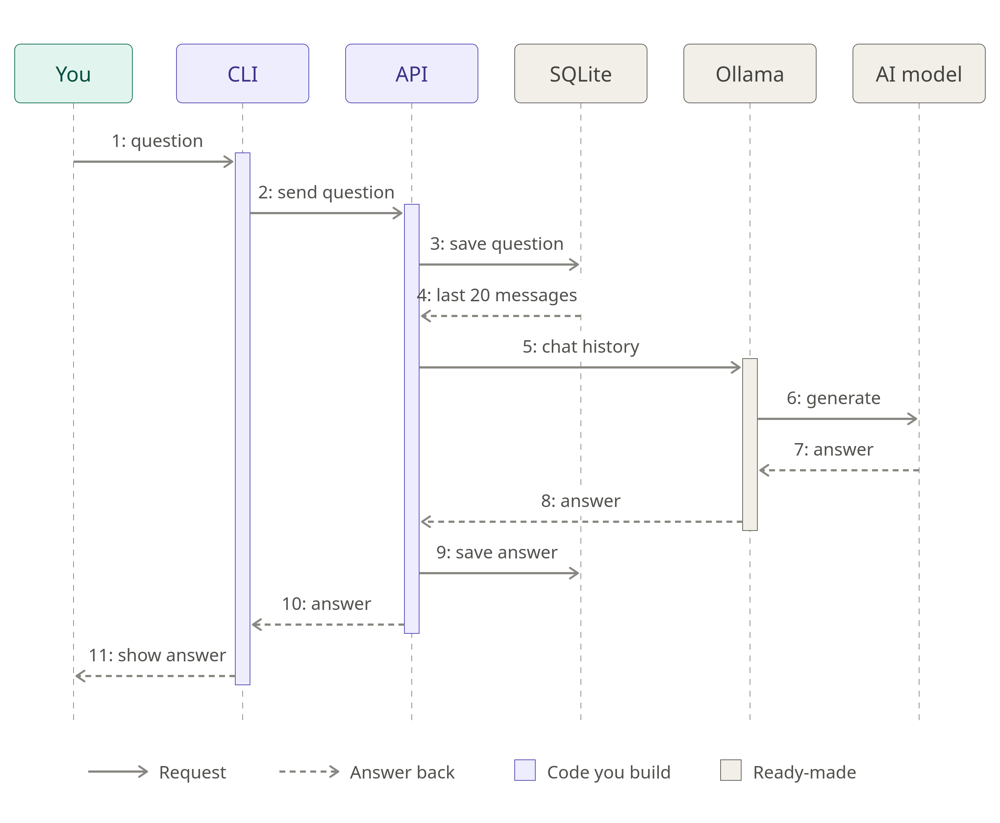

# MyAi – Private Local AI Assistant

A private AI chat assistant that runs completely on my own Ubuntu laptop and is used from the terminal, similar to Claude Code.
No data leaves the computer, and it works without an internet connection.

## Why this project?

Most AI chat tools send everything you type to a company's servers. This project explores a different approach:

- **Private:** all questions and answers stay on my own laptop.
- **Offline:** after the AI model is downloaded, no internet connection is needed.
- **Under my control:** I decide what the AI is allowed to do. This matters for later versions, where the AI can read and edit code.

## Features

### Version 1 (current goal)
- Start a new chat from the terminal
- The AI remembers earlier messages in the same chat
- List, open, and continue old chats
- Delete chats
- Choose which AI model to use

### Roadmap
- **Version 2:** the AI can read files and code on my laptop (read-only)
- **Version 3:** the AI can edit code, but only after I approve each change
- **Later:** use the assistant from my phone

## How it works

The system has five parts that work together:

| Part | What it does |
|---|---|
| **CLI** (C# console app) | Where I type my questions and see the answers |
| **API** (ASP.NET Core) | The "brain" in the middle: saves chats, loads history, talks to the AI |
| **SQLite** | Stores all chats and messages |
| **Ollama** | Runs the AI model locally |
| **AI model** | Generates the answers (for example Llama 3.2) |

**When I send a question:**

1. I type a question in the terminal.
2. The CLI sends it to the API.
3. The API saves the question in SQLite.
4. The API loads the last 20 messages of this chat (the chat history).
5. The API sends the chat history (which now ends with the new question) to Ollama.
6. Ollama runs the AI model.
7. The model generates an answer.
8. Ollama sends the answer back to the API.
9. The API saves the answer in SQLite.
10. The API sends the answer to the CLI.
11. The CLI shows the answer in the terminal.

The AI model has no memory of its own. That's why the API sends the recent chat history every time: **the database is the AI's memory.** Only the last 20 messages are sent, so the AI doesn't get overloaded. Older messages stay saved in the database, but the AI doesn't see them anymore.



## Tech stack

- **Language:** C# (.NET 10)
- **Backend:** ASP.NET Core Web API
- **Terminal app:** C# console app with Spectre.Console
- **Database:** SQLite with Entity Framework Core
- **AI:** Ollama with OllamaSharp

## Requirements

- Ubuntu (22.04 or newer)
- 8 GB RAM or more (small models like `llama3.2:1b` or `llama3.2:3b`)
- [.NET 10 SDK](https://dotnet.microsoft.com/)
- [Ollama](https://ollama.com/)
- Git
- DB Browser for SQLite (optional, to look at the data)

## Getting started

> Coming soon – the project is still being designed.

## Project structure

```
MyAi/
├── Api/        → backend API
├── Cli/        → terminal app
├── Shared/     → classes used by both
└── docs/       → UML diagrams
```

## License

Not licensed yet.